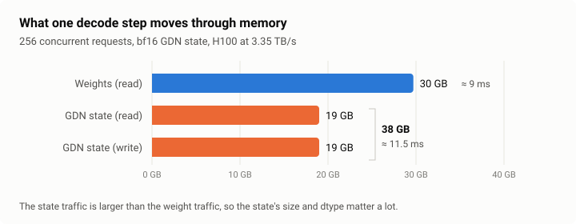
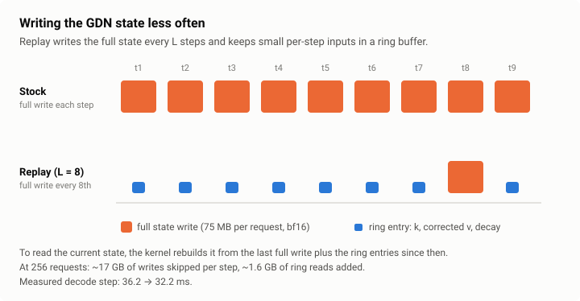
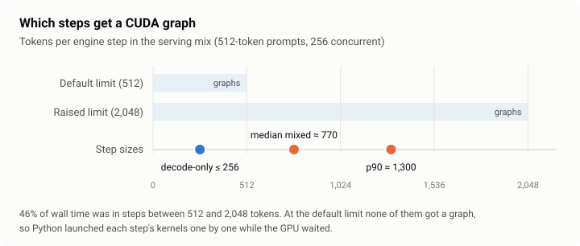
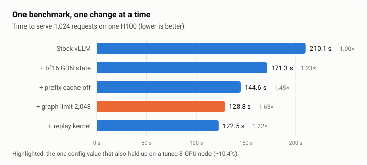
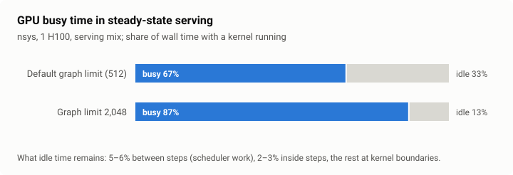
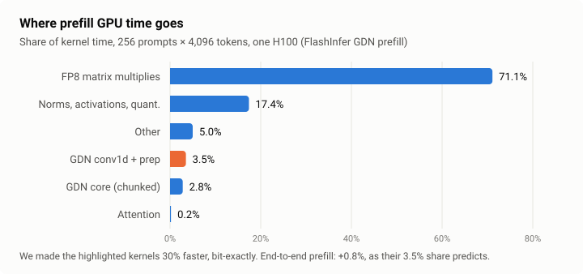

*Qwen3.8-27B-FP8 on vLLM 0.31: 1.72× over stock settings on one GPU (on traffic without shared prefixes), and +10% on an already-tuned 8-GPU node.*

Qwen3.8-27B is a *hybrid* model: most of its layers are a form of linear attention that keeps a fixed-size memory per request, instead of a cache that grows with every token. That changes where memory and time go when you serve it, and most published tuning advice assumes the other kind of model.

This is a case study of making it serve faster on H100s: what worked, what didn't, and how I found out. Nothing here is a new technique. The value is in the measurements, including the ones that went against me. The change that held up best was a single config value that controls which batch sizes get CUDA graphs, and I only found it after writing a custom kernel that was 1.4× faster in isolation, seeing it give 3% in a realistic serving benchmark, and asking why.

The sections follow the order I worked in, with the arithmetic that told me where to look.

All the code (kernels, benchmark scripts, figure script) is at [github.com/Noman654/hybrid-llm-serving](https://github.com/Noman654/hybrid-llm-serving).

---

## 0. The model, in numbers

Qwen3.8-27B is a hybrid. Of its 64 layers, 48 are Gated DeltaNet (GDN, a form of linear attention) and 16 are ordinary attention.

**Attention layers keep a KV cache that grows with the sequence.** 16 layers × 2 (K and V) × 4 KV heads × 256 dims × 2 bytes = **64 KB per token** in bf16 (32 KB in FP8).

**GDN layers keep a fixed-size state per request.** Each of the 48 layers holds a 48-head × 128 × 128 matrix. That's 37.7M numbers per request: **151 MB in fp32, 75 MB in bf16**, regardless of whether the request is 10 tokens or 10,000.

So one request's GDN state, in bf16, weighs as much as **1,150 tokens of KV cache**. At 256 concurrent requests it's 19 GB in bf16, or 39 GB in fp32, on an 80 GB GPU that also holds 27.6 GiB of weights.

Two consequences follow:

1. **Memory is shared between two pools.** Every byte of GDN state is a byte the KV cache can't use, and KV capacity sets how many requests run at once.
2. **Decode is a bandwidth problem.** Each decode step reads all the weights once (~9 ms at H100's 3.35 TB/s) and reads *and writes* every running request's GDN state (19 GB each way at 256 requests, ~11.5 ms). The state traffic is larger than the weight traffic.



> **Takeaway:** on a hybrid model, do the state-size arithmetic before anything else. It predicts where both the memory and the bandwidth go.

---

## 1. Stock vLLM: the starting point

Out of the box, vLLM served about **2.7k output tokens/s per GPU** on a fixed 1k-in / 512-out benchmark.

Profiling a decode step with nsys showed the GDN state-update kernel taking **26–33% of the step**, already running at **86% of peak memory bandwidth**. The FP8 weight GEMMs ran at 70–77% of bandwidth in decode and 65–68% of peak compute in prefill.

None of the big kernels had much headroom. When a kernel is already near the hardware limit, tuning it won't help much; you have to make it move fewer bytes.

---

## 2. Cheap wins: removing waste

| Change | Why it helps | Gain |
|---|---|---|
| bf16 GDN state instead of fp32 | Halves the state: more requests fit, and each decode step moves fewer bytes | +16% |
| Prefix caching off | On this model, turning caching on shrank the KV cache from 461k to 376k tokens. My test prompts share no prefixes, so the cache only cost memory | +19% |
| One model copy per GPU instead of tensor parallelism | The model fits on one H100, so splitting it only adds communication | 3.2k vs 2.2k tok/s per GPU |
| FP8 KV cache | Doubles KV capacity | +3% |

Together: **about 3.4k tok/s per GPU, +26%**, and the full 8-GPU node reached 28.0k output tok/s at 1k/512.

These percentages come from a fixed 1k-in / 512-out benchmark. Section 6 re-measures the same changes on a serving workload with varied lengths, where the numbers differ, so don't multiply the two.

What didn't help: other scheduler flags, FlashInfer attention, and MTP speculative decoding at high load (−7 to −17%; after the Section 5 fix it was roughly neutral, +1.5%, but cost accuracy on GSM8K, so I left it out). SGLang came in 2–3% behind vLLM.

On traffic that *does* share prefixes (system prompts, multi-turn chat), turning it on was worth **+49%** (measured with fp32 state). "Off" is right only for traffic like my benchmark.

> **Takeaway:** check what the defaults cost before writing any code. Mine cost 26%.

---

## 3. Splitting prefill and decode: when it wins and when it doesn't

**Why I tried it.** Prefill is compute-heavy and decode is bandwidth-heavy. When they share a step, a long prefill stalls every decode in the batch, and per-token latency spikes. Running them on separate GPUs (disaggregation) removes that interference.

Getting it working required KV and GDN state transfer over NIXL, a specific conv-state layout, and a multi-worker proxy, because a single-process proxy became the bottleneck first.

**Raw throughput: it lost.** The best split was 8–16% below the normal setup. Moving state between GPUs costs time, and the prefill GPUs sat idle on decode-heavy traffic (and vice versa).

**Under a latency target: it won.** With a target of first token under 2 s and under 30 ms per token, on ShareGPT traffic at a fixed offered request rate (runs of about 5 minutes):

| Setup (8 GPUs) | Load | Requests meeting the target |
|---|---|---|
| Normal (all GPUs do both) | 100 req/s | 18% |
| 2 prefill + 6 decode | 145 req/s offered, 136 completed | **99.6%** |

The nsys traces show why: decode GPUs that never see a prefill run clean steps with a p99 of 21 ms, against 69 ms when prefill is mixed in.

> **Takeaway:** disaggregation buys steady latency, not throughput. Decide which one you're optimizing before you build it.

I was after throughput, so the next place to look was the kernel Section 1 flagged as the biggest: the GDN state update.

---

## 4. A faster kernel, and a disappointing result

Section 0 says the GDN state is read *and written* every decode step. Most of those writes are redundant: the state changes by a small, structured update each token.

The GDN update is a decay plus a rank-1 correction. So instead of writing the full state every step, you can keep the last few steps' small inputs (keys, corrected values, cumulative decay) in a ring buffer, rebuild what you need from the last saved state plus the ring, and write the full state only every *L* steps. This is the idea behind [ReplaySSM](https://tridao.me/blog/2026/replayssm/) and, for GDN specifically, [DeltaLog](https://arxiv.org/pdf/2608.15533). I wrote my own Triton version for vLLM with *L* = 8.



**The arithmetic predicts the gain.** Skipping 7 of every 8 state writes at 256 requests saves 19 GB × 7/8 ≈ 17 GB of traffic per step. Reading the ring buffers adds back about 1.6 GB, so the net saving is about 15 GB: **4.6 ms** at peak bandwidth, or 5.3 ms at the 86% the stock kernel achieves. Measured: decode steps at 256 requests went from **36.2 ms to 32.2 ms**, a 4.0 ms saving.

| Batch size | 32 | 64 | 128 | 256 | 512 |
|---|---|---|---|---|---|
| Kernel alone (earlier standalone version, CUDA graphs, L = 16) | 1.07× | 1.18× | 1.33× | 1.38× | 1.41× |

Quality is less clean. On full GSM8K (1,319 questions) the kernel scored slightly below baseline in two independent setups: 6 questions lost / 3 gained, and 11 lost / 5 gained (p = 0.51 and 0.21; swapping only the KV cache dtype moves 9/10). DeltaLog keeps the value-side buffer in fp32, so I tried that: no change. Flushing every step (*L* = 1, so no deferral at all) still showed the dip, so deferral isn't the cause. The real comparison point turned out to be the decode path: stock vLLM decodes with a fused CUDA kernel, and my kernel replaces it with a Triton one. Stock vLLM forced onto its own Triton decode kernel scores 96.66% against 97.04% for the fused default, and my kernel matches that Triton baseline within noise (9 lost / 6 gained). None of these gaps is significant on its own, but the fused CUDA decode is the most accurate of the three.

Then I ran realistic serving: 1,024 requests through 256 slots, prompts of 512 tokens, outputs of 128–1,024. **End to end: +3%.**

> **Takeaway:** a kernel speedup is worth at most the share of wall time that kernel takes. I hadn't measured that share for realistic traffic.

---

## 5. Where did the time go?

The arithmetic in Section 0 predicts GPU memory and GPU bandwidth. It says nothing about the host, which is why this part had to be measured rather than reasoned out.

In steady-state serving, nsys showed the **GPU idle 33% of the time**. Most of the idle time wasn't one big stall; it was tens of thousands of short gaps between kernels.

A CPU profile (py-spy) showed the main Python thread spending 43% of its time *inside the forward pass, launching kernels*, and only 17% waiting for the GPU. The CPU, not the GPU, was setting the pace.

**Why?** vLLM captures CUDA graphs for batch sizes up to `max_cudagraph_capture_size`, which defaults to **512 tokens** on Hopper. A CUDA graph replays a whole step's worth of kernels with a single launch. Anything larger runs without a graph, so each of the step's hundreds of kernels is launched individually from the host.

Decode-only steps are small (≤ 256 tokens here), so they get graphs. But in real serving, most steps are *mixed*: a few prefill chunks plus all the running decodes. In my workload the median mixed step was **~770 tokens** and the 90th percentile ~1,300, and **46% of wall time** was spent in steps between 512 and 2,048 tokens. All of it ran without graphs.



**The fix is one setting:**

```python
compilation_config={"max_cudagraph_capture_size": 2048}
```

| | GPU busy | Serving time (1 GPU) |
|---|---|---|
| Default (512) | 67% | 142–145 s (5 runs) |
| 2,048 | **87%** | **128–129 s (+11%)** (6 runs) |

On 8×H100 with the tuned config from Section 2, on ShareGPT traffic from four parallel clients (a different benchmark from Section 2's 28.0k), the same change gave **+10.4%**: 27.8k → 30.7k output tok/s, averaged over alternating runs.

A note on versions: this is vLLM 0.31. Newer vLLM (after [#63406](https://github.com/vllm-project/vllm/pull/63406)) has a separate capture-size setting for prefill-sized steps, and after [#51012](https://github.com/vllm-project/vllm/pull/51012) oversized steps on this model family run fully eager, so on current main the knob is named differently and the gap is likely larger.

It isn't free:
- **Startup:** with 8 engines capturing in parallel on one host, the ~100 extra graph sizes took **7 minutes instead of 23 seconds** (and still ~7 minutes on a second start, so the compile cache doesn't save it), past vLLM's default 10-minute engine-ready timeout. Set `VLLM_ENGINE_READY_TIMEOUT_S` higher, or the API server gives up and leaves the engine processes holding your GPUs.
- **Memory:** graph memory grew 1.2 GiB per GPU, and the KV cache shrank about 2.5%. When the KV cache is already the limit (1,500-token prompts in my test), the net effect was about −1%.
- **Going higher doesn't help:** a 4,096 limit cost 9% of KV capacity and gave no further speedup.

**How to pick the limit for your traffic.** 2,048 is my answer, not a universal one. Log the token count of every step for a few minutes of real traffic, set the limit near the 90th percentile of mixed-step sizes, and stop raising it once the KV-cache loss starts to show in throughput.

Why didn't my tuning in Section 2 find this? Because that benchmark used near-equal lengths (1,024 in, 410–512 out), so requests moved through in waves and few steps mixed prefill with decode. I checked on 8 GPUs, alternating configs: 28.6k / 28.6k output tok/s at the default, 28.7k / 26.5k with the graph limit. No gain on the first pair, and the second graph-limit run was 7% slower for reasons I didn't track down. The setting pays off only when request lengths vary, as they do in real traffic.

> **Takeaway:** profile the idle time before optimizing the busy time. My bottleneck was Python launching kernels, and one config value fixed it.

---

## 6. The whole ladder

One benchmark, one GPU, one change at a time: 1,024 requests, 256 concurrent, 512-token prompts, output lengths uniform in 128–1,024.



| Step | Change | Total time | vs stock | KV cache |
|---|---|---|---|---|
| 0 | Stock vLLM | 210.1 s | 1.00× | 272k tokens |
| 1 | + bf16 GDN state | 171.3 s | 1.23× | 376k |
| 2 | + prefix cache off | 144.6 s | 1.45× | 461k |
| 3 | + graph limit 2,048 | 128.8 s | 1.63× | 446k |
| 4 | + replay kernel | 122.5 s | **1.72×** | 425k |

Notice the KV column in steps 1 and 2. Concurrency is fixed at 256, and 256 requests averaging ~1.1k tokens need about 280k tokens of KV, more than the 272k available at stock settings, so vLLM has to preempt and recompute some requests. Steps 1 and 2 remove that pressure; step 1 also halves the state bytes each decode step moves.

The kernel's share also grew: +3% end to end in Section 4, +5% here (128.8 → 122.5 s). Once the host overhead is gone, GPU kernel time is a bigger part of the wall clock, so a faster kernel moves it more.

FP8 KV cache isn't in the ladder; it is in the 8-GPU config.

Step 2 is only right for traffic without shared prefixes. The part that carries over to any traffic is steps 2→4: 144.6 s → 122.5 s, **1.18×**.

At node scale the replay kernel didn't hold up: it needs vLLM's older V1 model runner, and V2 with the graph limit alone (30.7k tok/s) matched V1 with graph limit plus replay (30.4k). It also gives up vLLM's fused CUDA decode kernel, which scored slightly higher on GSM8K (Section 4). So I'd ship steps 1–3 and leave the kernel out.

---

## 7. What I got wrong along the way

- **A wrapper script silently dropped my flag.** My launch script didn't forward extra arguments, so the "graph limit" runs on 8 GPUs were really baseline runs. They showed **+13.6%**, which was run-to-run noise. I caught it because the graph-memory line in the logs didn't change. Always check that a setting took effect.
- **Single runs lie.** One load-generating client at 2,048 concurrency varied by 6–13% between identical runs. Four parallel clients and alternating configs (A, B, A, B) fixed it.
- **Baseline vLLM isn't deterministic.** At the default graph limit, two identical GSM8K runs agreed on only 701 of 1,319 answers. (At a 2,048 limit my later baseline runs were bit-identical, which I haven't explained.) Any "my change didn't affect quality" claim needs at least two baseline runs as the noise floor.
- **An accuracy drop that wasn't one.** bf16 state with prefix caching appeared to cut GSM8K from 96.7% to 92%. It was an evaluation artifact: near-tied first tokens flipping to end-of-sequence. The model's state was restored bit-exactly.

---

## 8. What's left, and what doesn't apply

After the fix the GPU is idle about 13% of the time: 5–6% of wall time in gaps between steps (scheduler work), 2–3% in gaps inside steps, and the rest in the normal 1–2 µs boundary between consecutive kernels. Beyond that, the limit is GPU kernel time.



**Where the kernel time goes, and how little is left in the small kernels.** A prefill profile (256 prompts × 4,096 tokens) splits GPU kernel time like this: FP8 matrix multiplies 71%, activation quantization 7%, the GDN conv1d and its prep kernel 3.5%, the GDN core 2.8%, attention 0.2%. The matrix multiplies are the job; everything I could rewrite is small.



I tried the obvious one anyway. Stock vLLM runs the conv1d, writes its output to memory, and a second kernel reads it back to split q/k/v, L2-normalize q and k, and compute the gates. I fused the two into one Triton kernel. Two details decided whether it was worth anything:
- **Bit-exactness.** Rounding the conv output to bf16 before the norm, as stock does, wasn't enough: about 100 of 16.7 million values still differed by one bf16 step, because my sum of squares added the 128 values in a different order. Reproducing stock's order (each thread sums 8 values, then 16 threads combine in a butterfly) made q, k, v, gates and conv state identical bit for bit, so no accuracy test was needed.
- **Warps.** 2 warps per block was fastest (−30% kernel time); 8 warps was slower than stock.

| | Stock | Fused |
|---|---|---|
| conv1d + prep kernel time (prefill) | 706 µs | 490 µs (−30%) |
| End-to-end prefill throughput (9 runs each, alternating) | 19.14k tok/s | 19.29k tok/s (**+0.8%**) |
| Greedy outputs (64 prompts) | | token-identical |

The kernels got 30% faster, but they were only 3.5% of prefill time, so the whole model got 0.8% faster: 30% of 3.5% is about 1%, the most it could ever give. Same lesson as Section 4: check how much time a kernel actually takes before you rewrite it.

Some well-known techniques don't apply to this setup. Meta's [DDA all-reduce](https://engineering.fb.com/2025/10/17/ai-research/scaling-llm-inference-innovations-tensor-parallelism-context-parallelism-expert-parallelism/) speeds up communication between GPUs that share one model, but with one model copy per GPU there's no all-reduce to speed up.

## 9. What's next

- **AMD MI300X.** On AMD, vLLM runs the GDN layers through its Triton path, which took about 11% of prefill time on H100 against 2.8% for the fused kernel H100 uses by default. That's a real gap, and I haven't seen hybrid-model serving numbers published for MI300X.
- **Upstreaming the fused conv kernel.** It is bit-exact and pure Triton, so it should carry over to AMD as well.

If you serve a hybrid model and see different numbers, especially at high concurrency, I'd like to hear about it.

---

## Appendix: the config

```bash
export VLLM_ENGINE_READY_TIMEOUT_S=2400   # graph capture takes ~7 min on 8 GPUs
vllm serve Qwen/Qwen3.8-27B-FP8 \
  --language-model-only --max-model-len 8192 \
  --data-parallel-size 8 --api-server-count 8 \
  --mamba-ssm-cache-dtype bfloat16 --no-enable-prefix-caching \
  --kv-cache-dtype fp8 --async-scheduling \
  --gpu-memory-utilization 0.95 --max-num-seqs 512 --max-num-batched-tokens 16384 \
  --generation-config vllm --attention-backend FLASH_ATTN \
  --compilation-config '{"max_cudagraph_capture_size": 2048}'
```

Drop `--no-enable-prefix-caching` if your traffic shares prefixes.

Benchmark: `vllm bench serve` on ShareGPT, four clients at 512 concurrency each, configs alternated, two runs each.

The single-GPU benchmarks (ladder, GSM8K, ShareGPT, prefill) are `bench/` in the [code repo](https://github.com/Noman654/hybrid-llm-serving); the full config is `serve/serve.sh`.

Related: vLLM PR [#64825](https://github.com/vllm-project/vllm/pull/64825) proposes raising the default on Hopper for this model family; I posted my measurements there.

---

## Comments and reactions

<script src="https://giscus.app/client.js"
        data-repo="Noman654/hybrid-llm-serving"
        data-repo-id="R_kgDOVsyoUw"
        data-category="Announcements"
        data-category-id="DIC_kwDOVsyoU84DLBxh"
        data-mapping="pathname"
        data-strict="1"
        data-reactions-enabled="1"
        data-emit-metadata="0"
        data-input-position="top"
        data-theme="light"
        data-lang="en"
        data-loading="lazy"
        crossorigin="anonymous"
        async>
</script>
